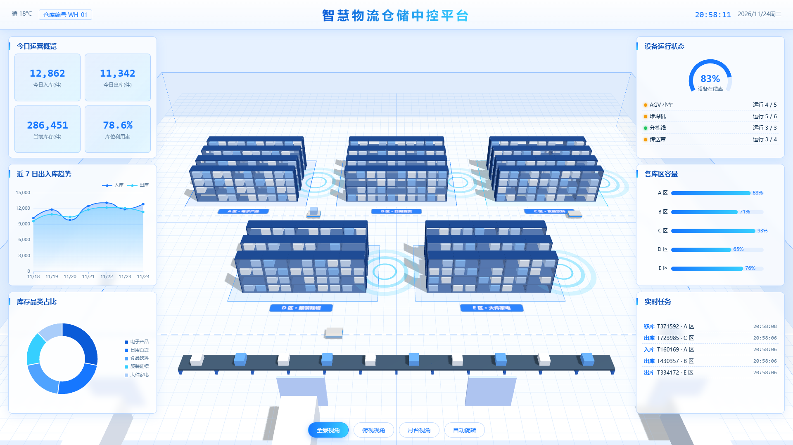

# 智慧物流仓储中控平台

一个基于 Three.js 的 3D 物流仓储可视化中控大屏，蓝白配色，展示仓库的库区布局、货架库存、AGV 小车、传送带和出入库数据。



## 功能

- **3D 仓库场景**：5 个库区、货架和货物、月台与货车，支持鼠标拖拽旋转和滚轮缩放
- **动态效果**：AGV 小车沿通道循环行驶，传送带上的货箱持续移动，库区有扩散光圈
- **货架信息**：鼠标悬停在货架上，显示所属库区、编号、层数和利用率
- **视角切换**：全景、俯视、月台三个视角，平滑过渡，支持自动旋转
- **数据面板**：今日出入库、库存、库位利用率、近 7 日趋势、品类占比、设备在线率、库区容量、实时任务流

> 页面中的数据均为前端模拟数据，用于演示效果，没有接入真实后端。

## 技术栈

- [Three.js](https://threejs.org/)：3D 场景渲染
- [ECharts](https://echarts.apache.org/)：图表
- [Vite](https://vite.dev/)：开发和打包

## 本地运行

需要先安装 [Node.js](https://nodejs.org/)（18 及以上）。

```bash
npm install
npm run dev
```

浏览器打开终端里显示的地址（默认 http://localhost:5173）。

打包：

```bash
npm run build
```

产物在 `dist/` 目录，可直接部署到任意静态服务器。

## 目录结构

```text
├── index.html        页面结构（顶栏、左右数据面板、底部按钮）
├── public/           静态资源
├── src/
│   ├── main.js       图表、数据面板、实时任务模拟
│   ├── scene.js      3D 场景：地面、货架、AGV、传送带、月台
│   └── style.css     蓝白科技风样式
└── vite.config.js
```
